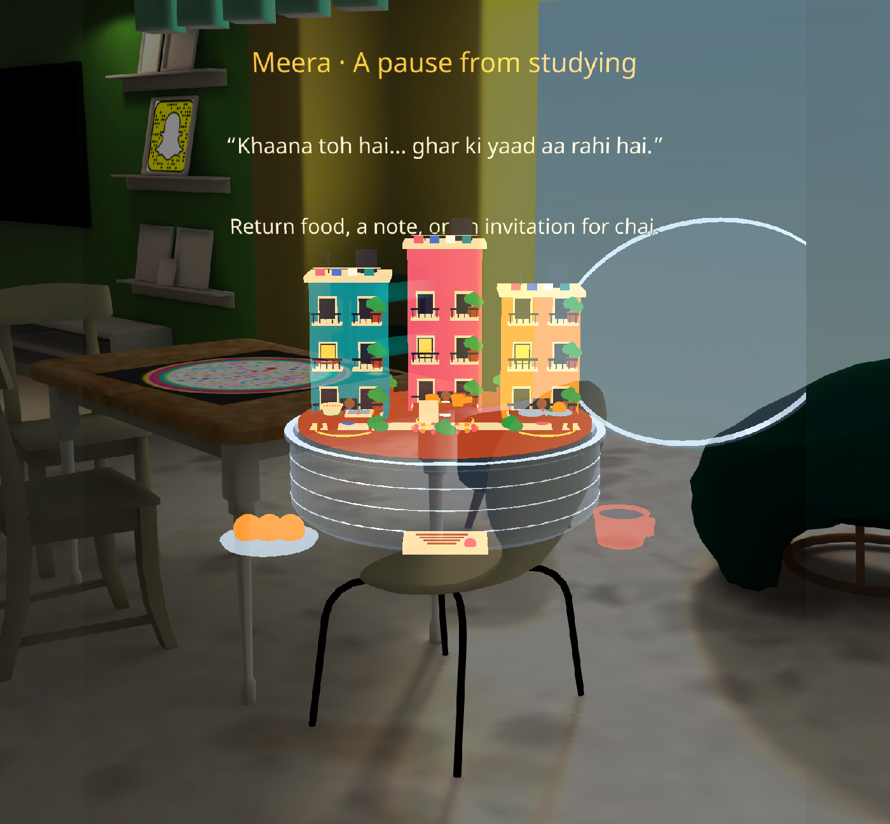
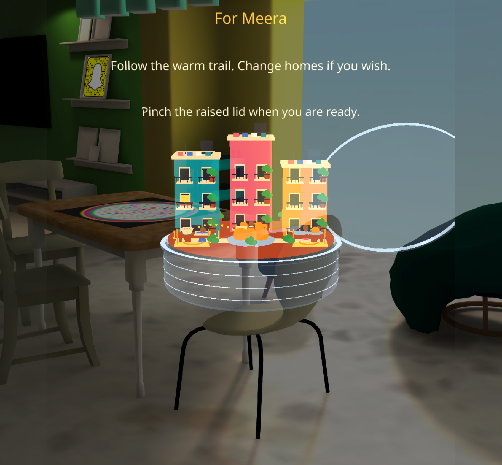
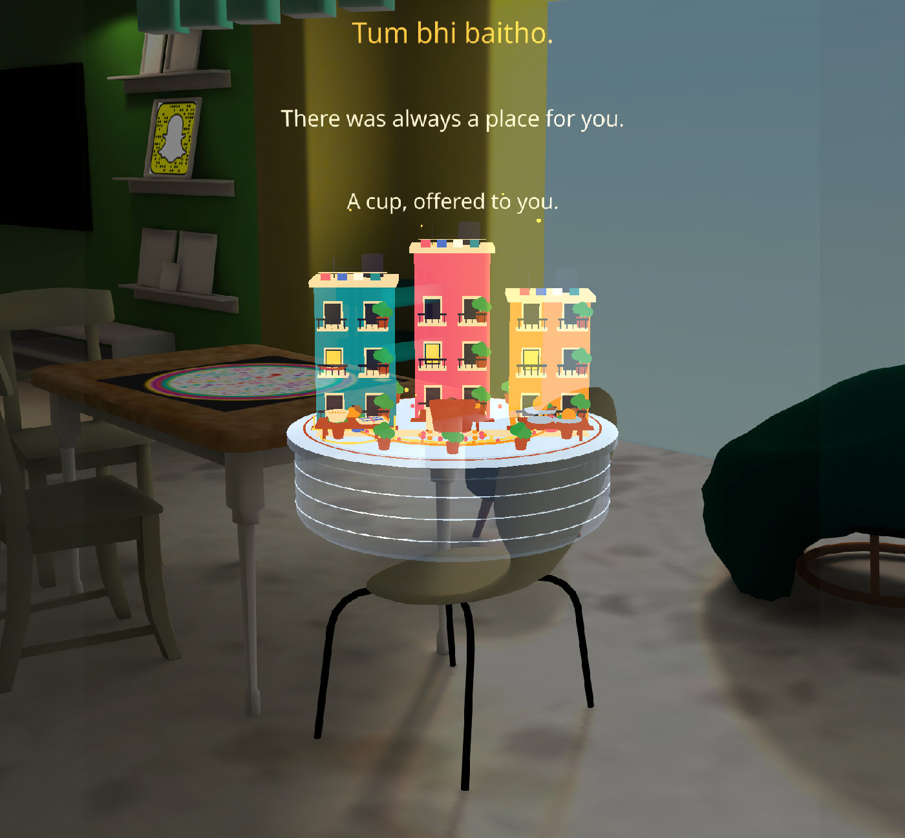

# Khaali Dabba Nahi Lautate

**खाली डब्बा नहीं लौटाते — an everyday Indian magic story for Specs.**

Sharma Aunty sends you a steel dabba of homemade laddoos. When the sweets are gone, a miniature Indian neighborhood emerges. Meet its residents, choose a thoughtful return gesture, and watch kindness travel from home to home.

> Dabba khaali tha. Rishta nahi.

## About the project

**Khaali Dabba Nahi Lautate** means “you don't return an empty food container.” The experience draws on a familiar Indian gesture: a neighbour sends something homemade, and the container returns with something thoughtful inside. Here, that small exchange becomes a tabletop story about belonging in a new neighbourhood.

You are the newcomer. Sharma Aunty's dabba is your first welcome; the miniature mohalla inside introduces people whose everyday objects reveal what they might need. There is no score, countdown, or wrong gift. The central choice is whom you notice and how you respond.

The final invitation, **“Tum bhi baitho” — “Come, sit with us too”**, brings the story back to the wearer. You have become part of the neighbourhood you helped bring together.

## Meet the mohalla

| Resident | Household clue | What the story invites you to notice |
|---|---|---|
| **Sharma Aunty** | An extra plate at dinner | Her welcome always leaves room for another person. |
| **Iyer Uncle** | Two cups and an empty chair | A familiar routine can also be an invitation to company. |
| **Meera** | Untouched noodles beside a study book | A student preparing for exams could use a little care and a break. |

Discovering one clue opens the return gifts. You can continue exploring the other homes at your own pace. Choose **food, a handwritten note, or a chai invitation**, then explicitly address the dabba to a resident. All nine gift-and-recipient combinations have dialogue; kindness is not treated as a matching puzzle.

## Why a spatial experience?

The story happens around a container on your table. Opening its lid, taking the sweets, leaning in to inspect a tiny home, and carrying a gift back into the dabba make the exchange physical. Doorstep targets and a warm dotted trail connect your choice to a particular person. Their response changes the miniature scene before the whole neighbourhood gathers.

This is a single-player, hand-interactive experience for Specs. Its focus is an intimate cultural story told through objects, gestures, and small visible changes.

## See the experience

| Discover the residents | Choose a recipient |
|---|---|
|  |  |

Screenshots are from Lens Studio Preview. See the [validation report](Assets/KhaaliDabba/VALIDATION.md) for the interaction checks behind them.

## Play the project

1. Clone this repository and open `HACKPROJECT.esproj` in **Lens Studio 5.24.1 or a compatible newer version**.
2. Let Lens Studio import the assets and packaged dependencies.
3. For Editor testing, choose **SPECS 27 → Interactive** in Preview. The Editor uses authored placement; physical table scanning requires glasses.
4. Pinch the lid and the three laddoos to reveal the miniature mohalla. Notice a household clue, then carry food, a note, or a chai invitation into the dabba.
5. Pinch a glowing doorstep to choose the recipient. A warm trail and the person's name confirm your choice; you can change homes before closing the lid.
6. Return the lid. Watch the personal response, Aunty's acknowledgement, and the neighborhood gathering. A cup comes toward you: **“Tum bhi baitho.”** Pinch the diya after the closing line to replay.

SIK supplies supported hand targeting and pinch interactions. The project does not require eye tracking. Normal play is untimed, designed for about 3–4 minutes of exploration.

## What is implemented

- Separate steel dabba and animated lid, besan laddoos, and readable Hindi paper note.
- Staggered miniature neighborhood reveal, balconies, plants, clotheslines, residents, opening doors, and cascading window lights.
- Three interactive household clues: Meera's untouched noodles and study book, Uncle's two cups and empty chair, and Aunty's extra plate. One discovery unlocks gifts; further exploration is optional.
- Deliberate doorstep recipient selection, named confirmation, and warm address trails.
- Nine gift/resident dialogue combinations, personal deliveries, and distinct physical responses: a book put aside, a chair pulled closer, and a spare plate moved forward.
- Aunty's acknowledgement before the neighborhood celebration, followed by an invitation that includes the player.
- Physical gift pickup, drag and release, missed-drop recovery, and replay.
- Original generated music and sound effects; optional inputs for recorded Hindi narration.
- Verified **83.1-second** automatic concept demo: enable `demoMode` on `KhaaliDabbaGame`. Leave it disabled for interactive play.

## Source

The project uses **TypeScript**, **Spectacles Interaction Kit (SIK)** for hand interactions, **Spectacles UIKit** for spatial text, and **WorldQuery** for physical-surface placement. Procedural geometry creates the dabba, food, architecture, and articulated residents. Local music and sound effects support the story; no cloud backend or AI service is needed for the core experience.

| File | Responsibility |
|---|---|
| `Assets/KhaaliDabba/KhaaliDabbaGame.ts` | Story state, interactions and animations |
| `Assets/KhaaliDabba/KhaaliGeometry.ts` | Lightweight articulated procedural geometry |
| `Assets/KhaaliDabba/KhaaliDabbaPlacement.ts` | WorldQuery surface placement and pinch guards |
| `Assets/KhaaliDabba/KhaaliDabbaUI.ts` | UIKit spatial subtitles and Hindi note |
| `Assets/KhaaliDabba/Materials/` | Steel shaders and materials |
| `Assets/GeneratedSFX/` | Music, sound cues and PCM verification |
| `Packages/` | Pinned Lens Studio dependency packages and metadata |

See the [play guide](Assets/KhaaliDabba/README.md), [validation report](Assets/KhaaliDabba/VALIDATION.md), [DJX design review](Assets/KhaaliDabba/DJX_REVIEW.md), and [session handoff](Assets/KhaaliDabba/NEXT_SESSION.md).

## Validation and limits

Compilation, runtime startup, doorstep selection and switching, all three gift types, missed-drop recovery, physical response animations, the final invitation and replay were checked in Lens Studio Preview. The nine dialogue combinations exist in source; three representative complete gift/recipient paths were played end-to-end. Physical table placement, stereo comfort and sustained performance still need on-glasses testing. Hindi text is included; recorded Hindi narration is not included. Visuals are a stylized playable prototype.

Lens Studio regenerates `Cache/` and `Support/` after opening the project. Local MCP credentials, editor workspaces and generated caches are excluded from Git. Vendor SDK packages remain subject to their own terms; no license is granted here for those dependencies.

## Project status and next steps

The current build is a **playable prototype**, with the complete opening, three household clues, gift selection, explicit recipient selection, personal responses, communal finale, and replay implemented. The automatic demo provides a repeatable overview; interactive play remains the intended experience.

The next production priorities are on-glasses testing of placement and hand comfort, stereo readability and sustained performance, followed by recorded Hindi narration and first-time-user playtesting. These are remaining tasks, not completed or certified capabilities.

For development, open the project in Lens Studio, keep `demoMode` disabled for manual testing, and start with the [session handoff](Assets/KhaaliDabba/NEXT_SESSION.md). The [asset play guide](Assets/KhaaliDabba/README.md) explains authoring and controls, while the [DJX design review](Assets/KhaaliDabba/DJX_REVIEW.md) records the narrative decisions and their limits.
